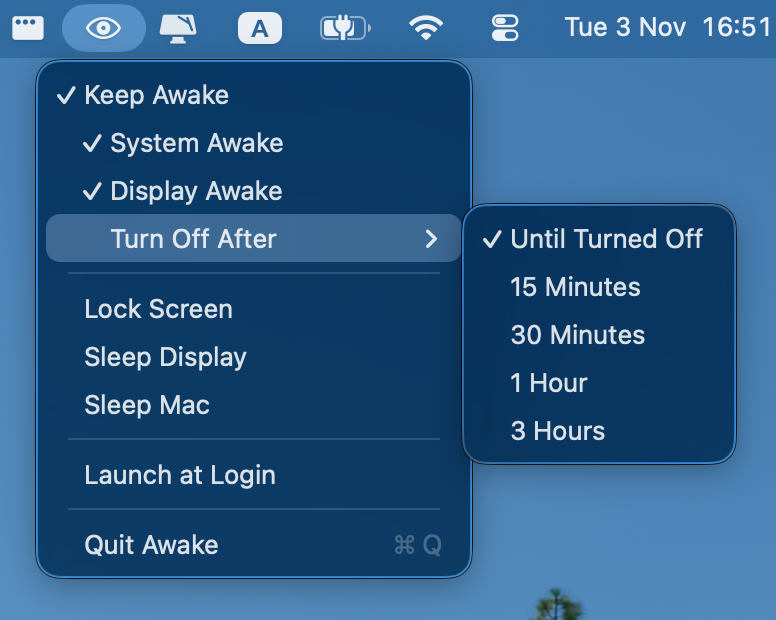

# Awake

Menu bar utility for macOS that temporarily keeps your Mac awake — without changing System Settings.

Awake creates short-lived [power assertions](https://developer.apple.com/library/archive/qa/qa1340/_index.html) so idle sleep and display sleep stay off until you turn them off (or a timer expires). Quitting the app releases every override automatically.



## Features

**Overrides** (independent toggles)

- **System Awake** — blocks idle system sleep
- **Display Awake** — blocks idle display sleep (and effectively the screensaver)
- **Keep Awake** — turns both on or off together

**Timed sessions**

- Until turned off, or auto-off after 15 minutes / 30 minutes / 1 hour / 3 hours
- Remaining time shows in the menu while a timer is running

**One-shots**

- Lock Screen
- Sleep Display
- Sleep Mac

**Other**

- Launch at Login
- Menu bar only (no Dock icon) — `LSUIElement`
- Menu bar icon: half-closed eye when idle, open eye while an override is active

## Requirements

- macOS 26 or later
- Xcode 27 or later (to build from source)

## Install

### From a release package

1. Download `Awake-*.zip` or `Awake-*.dmg` from [Releases](https://github.com/DSrhoj/awake/releases)
2. Drag **Awake.app** into **Applications**
3. First launch: **right-click → Open** (ad-hoc / personal builds are not notarized)

### From source

```bash
git clone https://github.com/DSrhoj/awake.git
cd awake
xcodebuild -scheme Awake -configuration Release -derivedDataPath build
open build/Build/Products/Release/Awake.app
```

Or open `Awake.xcodeproj` in Xcode, select the **Awake** scheme, and press Run (⌘R).

## Usage

Click the eye icon in the menu bar:

| Item | Behavior |
|------|----------|
| Keep Awake | Enable or disable both system and display overrides |
| System Awake / Display Awake | Toggle each assertion independently |
| Turn Off After | Choose how long overrides stay on |
| Lock Screen / Sleep Display / Sleep Mac | Immediate system actions |
| Launch at Login | Register or unregister via `SMAppService` |
| Quit Awake | Releases overrides and exits |

## How it works

| Piece | Role |
|-------|------|
| `PowerAssertionManager` | `IOPMAssertionCreateWithName` for system and display idle sleep |
| `AwakeSessionTimer` | Optional auto-off countdown |
| `StatusItemController` | Menu bar UI and icon state |
| `SystemActions` | Lock / sleep via private lock API or `pmset` |
| `LaunchAtLogin` | `SMAppService.mainApp` registration |

Assertions only block **idle** sleep. Lid close, Apple menu **Sleep**, and critical battery still win.

## Package for distribution

Build a Release `.app` and wrap it as ZIP (and DMG when `hdiutil` is available):

```bash
./scripts/package.sh
```

Outputs in `dist/`:

- `Awake-<version>.zip` — unzip, drag into Applications
- `Awake-<version>.dmg` — same, disk-image style (when packaging succeeds)

Version comes from `CFBundleShortVersionString` in `Awake/Info.plist`.

### Publishing a GitHub Release

1. Bump `CFBundleShortVersionString` / `CFBundleVersion` in `Awake/Info.plist`
2. Commit and tag, e.g. `git tag v1.0.0 && git push --tags`
3. Run `./scripts/package.sh`
4. Create a GitHub Release for the tag and attach `dist/Awake-*.zip` (and `.dmg` if present)

## Project layout

```
Awake/                  App sources + Info.plist + entitlements
Awake.xcodeproj/        Xcode project (shared Awake scheme)
scripts/package.sh      Release build → ZIP/DMG
```

Bundle ID: `com.awake.app` · Sandbox: off (needed for power assertions / system actions)

## Notes & limits

- Closing the app releases all overrides.
- Per-display / clamshell control is out of scope for v1.
- Notarization and Developer ID signing are not configured; Gatekeeper will warn on first open of personal builds.
- Finder uses the black eye AppIcon; the menu bar uses SF Symbols (`eye` / `eye.half.closed`).

## License

[MIT](LICENSE)
